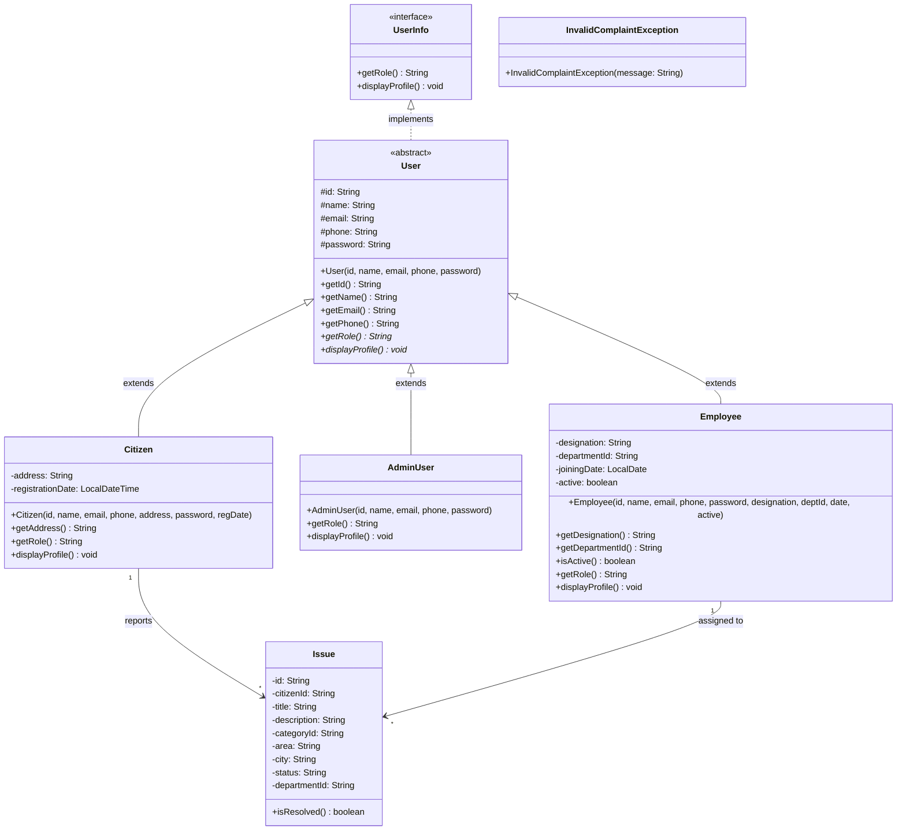

# CivicConnect – Municipal Issue Reporting and Resolution Management System

A standalone Core Java console application that bridges the communication gap between citizens and municipal authorities. Citizens can report civic issues (such as broken roads, garbage dumping, pipeline leaks, streetlights, and drainage), municipal administrators review and allocate issues to appropriate departments and field resolvers, and resolvers remediate the problems on-site with full audit trail logging and citizen feedback.

---

## 1. Project Introduction

In modern urban municipalities, citizens frequently encounter civic infrastructure issues such as potholes, uncollected garbage, water pipeline bursts, malfunctioning streetlights, and open drains. Traditional manual complaint mechanisms often lack transparency, issue tracking, and direct accountability. 

**CivicConnect** is designed as a structured, modular, console-based Java application demonstrating clean Object-Oriented Programming (OOP) concepts, collection frameworks, and robust exception handling.

---

## 2. Problem Statement

Municipal grievance reporting suffers from several common challenges:
- Absence of a centralized, accessible portal for citizens to lodge and monitor municipal defects.
- Lack of clear departmental categorization and automated tracking numbers.
- Inability of municipal administrators to balance resolver workloads and track ticket statuses.
- Absence of citizen satisfaction feedback loops after an issue is resolved.

CivicConnect addresses these issues by providing a clear three-tier role-based system: **Citizen**, **Administrator**, and **Resolver**.

---

## 3. Project Objectives

1. **Demonstrate Core Java & OOP Principles**: Implement practical inheritance, abstraction, polymorphism, interfaces, and encapsulation.
2. **Eliminate Code Duplication**: Create a common `User` superclass implementing a `UserInfo` interface.
3. **Robust Input Validation & Custom Exceptions**: Prevent application crashes through systematic validation and a custom `InvalidComplaintException`.
4. **Effective Collections Usage**: Demonstrate `HashMap` for fast $O(1)$ lookups, `ArrayList` for chronological audit logs, and `HashSet` for uniqueness.
5. **Beginner-Friendly Architecture**: Maintain clear, explainable code suitable for academic evaluation while delivering complete real-world functionality.

---

## 4. Project Scope

- **User Roles Supported**: Citizen, Municipal Administrator, Resolver (Field Officer).
- **In-Memory Storage**: Uses an in-memory `DataStore` with preloaded municipal data (resets on application exit).
- **Execution Environment**: Runs entirely within standard terminal/console on Java 8+. No external databases, GUI, or web frameworks required.

---

## 5. Main Features

### A. Citizen Module (`citizen` package)
- **Self-Service Registration**: Auto-generates unique Citizen IDs (`CIT-1004`), checks email uniqueness, and validates phone numbers.
- **Report Civic Issue**: File complaints with auto-generated Issue IDs (`ISS-1006`), title, description, category, neighborhood/area, city, state, landmark, and photo attachments.
- **Track Status**: Real-time lifecycle monitoring:
  $$\text{Reported} \longrightarrow \text{Under Review} \longrightarrow \text{Assigned} \longrightarrow \text{In Progress} \longrightarrow \text{Resolved}$$
- **View Comprehensive Details & History**: View complete complaint information and step-by-step audit history.
- **Submit Feedback**: Rate resolved complaints (1 to 5 stars) with remarks. Restricted to resolved complaints and enforced once per complaint.
- **Profile Management**: View and update profile information.

### B. Municipal Admin Module (`admin` package)
- **Citizen Directory**: List all citizens and search citizen details by ID.
- **Complaint Management**: View, filter by category or status, and search by complaint ID.
- **Category & Department Management**: Full CRUD operations for municipal departments and issue categories (with safety checks preventing deletion if in use).
- **Resolver Management**: Register resolvers, assign departments, and toggle active/inactive status.
- **Assign Issues**: Allocate pending issues to active department resolvers with specific directives.
- **Audit Monitoring**: View end-to-end status progression for any complaint.
- **Reject Out-of-Scope Reports**: Reject invalid complaints with recorded reasons.
- **System Analytics**: Dynamic statistics dashboard showing total citizens, active resolvers, issue status counts, and average citizen satisfaction rating.

### C. Resolver Module (`resolver` package)
- **Assigned Queue**: View complaints specifically assigned to the logged-in field officer.
- **Status Lifecycle Progression**: Update status from `Assigned` $\rightarrow$ `In Progress` $\rightarrow$ `Resolved` with mandatory field remarks.
- **On-Site Inspection Notes**: Log progress remarks without altering the complaint state.
- **Assignment History**: View complete past and present assignments with completion dates.
- **Profile Management**: View officer credentials, department, and contact info.

---

## 6. Technologies and Java OOP Concepts Used

| OOP Concept | Where and How It Is Used |
| :--- | :--- |
| **Interface** | `UserInfo.java` defines the contract (`getRole()` and `displayProfile()`) implemented by all system users. |
| **Abstraction** | `abstract class User` in `admin.User` provides the base blueprint and template for all system users. |
| **Inheritance** | `Citizen`, `AdminUser`, and `Employee` all extend `User`, inheriting common fields (`id`, `name`, `email`, `phone`, `password`) and reducing code duplication. |
| **Polymorphism** | Runtime polymorphism via method overriding: `getRole()` returns role-specific strings ("Citizen", "Administrator", "Resolver") and `displayProfile()` displays custom profile formats. |
| **Encapsulation** | All entity fields are declared `private` or `protected`, with validation logic inside public getters and setters. |
| **Custom Exception** | `InvalidComplaintException.java` is thrown when searching for non-existent complaints, assigning closed issues, or submitting invalid complaint data. |
| **Java Collections** | - `HashMap<String, T>`: Fast key-based ID lookups for citizens, resolvers, issues, departments, and categories.<br>- `ArrayList<T>`: Chronological storage of assignments, status updates, and feedback.<br>- `HashSet<String>`: Ensures uniqueness of assigned issue IDs without duplicates. |
| **Input Validation** | `safeInt` and string validators prevent crashes from non-numeric input, empty inputs, or out-of-range choices. |

---

## 7. Package and File Structure

```
Project-Java/
│
├── Main.java                          <-- Console entry point & main navigation menu
├── README.md                          <-- Project documentation & architecture guide
│
├── admin/                             <-- Municipal Admin Module & Shared Models
│   ├── UserInfo.java                  (Interface contract for all user types)
│   ├── User.java                      (Abstract superclass demonstrating Abstraction & Inheritance)
│   ├── InvalidComplaintException.java (Custom Exception for complaint handling)
│   ├── AdminUser.java                 (Admin entity subclass extending User)
│   ├── AdminModule.java               (Admin control desk and workflows)
│   ├── Category.java                  (Issue classification entity)
│   ├── Department.java                (Municipal department entity)
│   ├── Issue.java                     (Core civic complaint entity)
│   ├── StatusUpdate.java              (Audit trail history entry)
│   └── DataStore.java                 (Central in-memory store with sample data & collections)
│
├── citizen/                           <-- Citizen Module
│   ├── Citizen.java                   (Citizen entity subclass extending User)
│   ├── CitizenModule.java             (Registration, complaint reporting, tracking, feedback)
│   └── Feedback.java                  (Citizen rating and satisfaction review entity)
│
└── resolver/                          <-- Resolver Module
    ├── Employee.java                  (Resolver field officer entity extending User)
    ├── Assignment.java                (Assignment relationship entity linking Issue & Resolver)
    └── ResolverModule.java            (Field officer workbench, status updates, remarks)
```

---

## 8. Class Diagram (Mermaid)



---

## 9. How to Compile and Run

### Prerequisites
- JDK 8 or higher (Java 11, 17, 21, or 25 recommended)
- Terminal / PowerShell

### Execution (Single Command - Java 11+)
You can run the application directly from the root folder:
```powershell
java Main.java
```

### Traditional Compilation & Execution
```powershell
# Compile all packages
javac admin/*.java citizen/*.java resolver/*.java Main.java

# Run the program
java Main
```

---

## 10. Sample Test Credentials (Preloaded)

### Municipal Admin
- **Email**: `admin@civicconnect.gov`
- **Password**: `Admin@123`

### Preloaded Citizens
- `aarav.mehta@example.com` / `Citizen@123` (Has resolved issue `ISS-1001` and under-review issue `ISS-1004`)
- `neha.gupta@example.com` / `Citizen@123` (Has in-progress issue `ISS-1002` and reported issue `ISS-1005`)
- `vikram.singh@example.com` / `Citizen@123` (Has assigned issue `ISS-1003`)

### Preloaded Resolvers (Field Officers)
- `rajesh.resolver@civic.gov` / `Pass@1001` (Roads Dept `DEP-101`)
- `priya.resolver@civic.gov` / `Pass@1002` (Sanitation Dept `DEP-102`)
- `amit.resolver@civic.gov` / `Pass@1003` (Water Supply Dept `DEP-103`)
- `sunita.resolver@civic.gov` / `Pass@1004` (Electrical Dept `DEP-104`)

---

## 11. Current Limitations & Future Improvements

### Current Limitations:
- **In-Memory Volatility**: Data resets when the application terminates, as database persistence (JDBC/MySQL) was deliberately excluded per the evaluation rubric constraints.
- **Single-Node Terminal Interface**: Designed as a console text interface without web or mobile clients.

### Future Improvements:
1. **Persistent Storage (JDBC/JPA)**: Integrate MySQL/PostgreSQL using JDBC for durable relational storage.
2. **REST API & Web UI**: Build a Spring Boot REST API with a React or mobile frontend.
3. **Geo-Location Integration**: Support GPS coordinates and interactive GIS municipal maps for complaint pins.
4. **Automated Notification Engine**: Send SMS and email alerts to citizens upon status updates.
